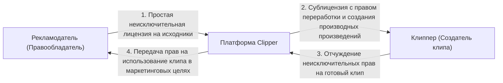

---
title: Интеллектуальная собственность и лицензирование (IP & Licensing)
type: legal
status: active
priority: high
created: 2026-10-31
updated: 2026-10-31
tags:
  - konveer
  - legal
  - ip
  - copyright
---

# 🛡️ Интеллектуальная собственность и авторские права (ГК РФ Часть 4)

## 1. Лицензионная цепочка (Rights Clearance)

Главная опасность для клипперов — получение страйков по авторским правам (Content ID на YouTube, претензии в VK) и блокировка аккаунтов. Для защиты сторон внедрена безотзывная сквозная лицензия:

### Ключевые положения договора:
1. **Гарантии рекламодателя (ст. 1252 ГК РФ):** Заказчик гарантирует, что предоставленные исходные материалы не нарушают авторских и смежных прав третьих лиц (включая музыку, изображения, товарные знаки). В случае претензий правообладателей все убытки и штрафы возмещает рекламодатель.
2. **Право на переработку (ст. 1270 ГК РФ):** Клиппер получает законное право осуществлять монтаж, нарезку, субтитрирование, кадрирование и наложение графических оверлеев на предоставленные видеоматериалы.
3. **White-list каналов клипперов:** Рекламодатель обязуется не подавать жалобы по DMCA / ст. 1253 ГК РФ на видеоролики, опубликованные с указанием проверочного кода `#clip_USERID`.

Связанные документы:
- [[07 - LEGAL/Terms of Service & Privacy Policy|Пользовательское соглашение]]
- [[07 - LEGAL/Legal Structure & Regulatory Compliance (RU)|Юридическая структура]]
