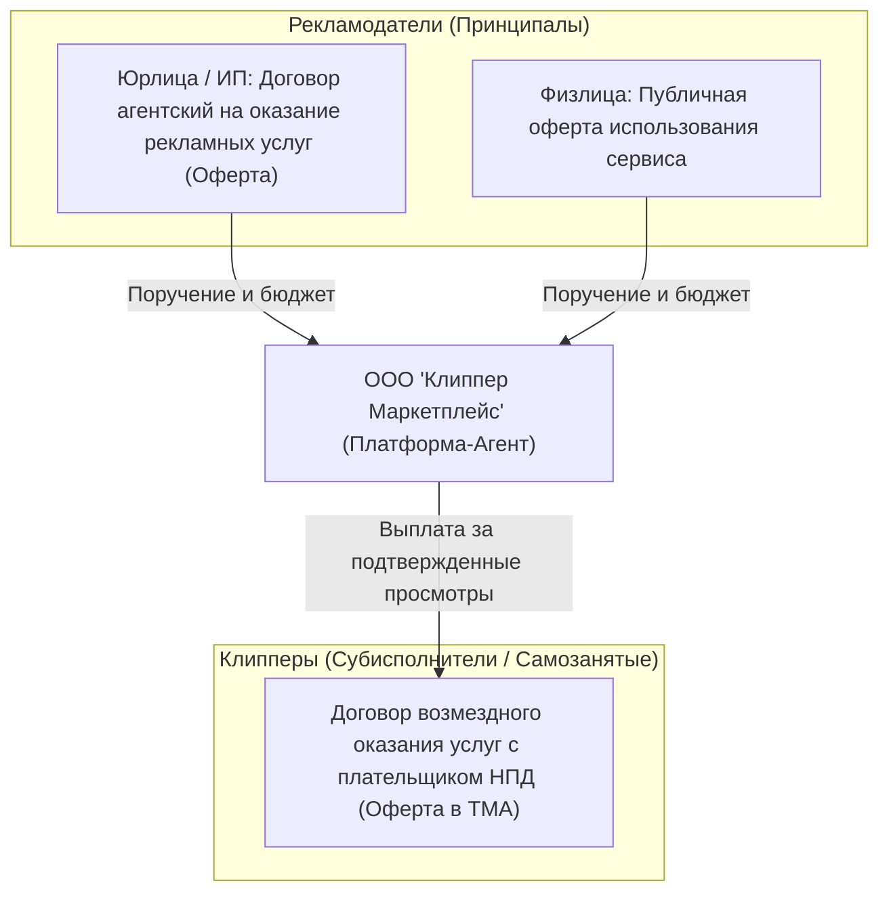

---
title: Юридическая структура и комплаенс РФ (Legal Structure & Compliance)
type: legal
status: active
priority: critical
created: 2026-10-31
updated: 2026-10-31
tags:
  - konveer
  - legal
  - compliance
  - russia
---

# ⚖️ Юридическая структура и регуляторный комплаенс в РФ

> [!NOTE]
> Настоящий документ представляет собой аналитическую и инженерно-правовую модель функционирования сервиса в правовом поле РФ. Все положения подлежат финальной верификации профильным юристом по IT-праву и налогообложению перед запуском юридического лица.

---

## 1. Организационно-правовая форма компании

* **ОПФ:** Общество с ограниченной ответственностью (**ООО**) на территории РФ.
* **Система налогообложения:** 
  * На старте (до оборота 450 млн ₽ в год): **УСН «Доходы за вычетом расходов» (15%)** либо **УСН «Доходы» (6%)**.
  * Рекомендация: **УСН 6% с агентским договором**. При агентской схеме налогооблагаемой базой ООО является **исключительно агентское вознаграждение платформы (20% комиссии)**, а не весь входящий оборот (GMV).
* **Коды ОКВЭД:**
  * `62.01` — Разработка компьютерного программного обеспечения.
  * `63.11` — Деятельность по обработке данных, предоставление услуг по размещению информации.
  * `73.11` — Деятельность рекламных агентств (основной для взаимодействия с рекламодателями).
  * `73.12` — Представление в средствах массовой информации.

---

## 2. Комплекс договоров платформы

---

## 3. Соответствие 152-ФЗ «О персональных данных»

1. **Локализация баз данных (ст. 18 ч. 5 152-ФЗ):** Серверы баз данных (PostgreSQL) и S3 хранилище размещаются строго в дата-центрах на территории РФ (Selectel, Санкт-Петербург).
2. **Уведомление Роскомнадзора:** Подача уведомления о начале обработки персональных данных в территориальный орган РКН до запуска открытой регистрации.
3. **Минимизация данных:** Для клипперов не запрашиваются сканы паспортов на старте. Идентификация проводится через банковский идентификатор СБП и ИНН плательщика НПД в момент выплаты.

Связанные документы:
- [[07 - LEGAL/Terms of Service & Privacy Policy|Пользовательское соглашение]]
- [[07 - LEGAL/Advertising Law & ORD Compliance (347-FZ)|Маркировка рекламы]]
- [[07 - LEGAL/Taxation & Payout Models (Self-Employed, IP, NPD)|Налогообложение]]
