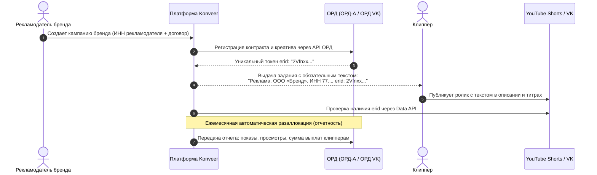

# Маркировка Интернет-Рекламы и Интеграция с ОРД (347-ФЗ)

Документ описывает регламент обязательного учета интернет-рекламы в Едином реестре интернет-рекламы (ЕРИР Роскомнадзора) через операторов рекламных данных (ОРД) в соответствии со ст. 18.1 Федерального закона № 38-ФЗ (в ред. 347-ФЗ).

---

## 1. Законодательные требования и риски штрафов

С сентября 2023 года за отсутствие маркировки интернет-рекламы действуют административные штрафы (ст. 14.3 КоАП РФ):
- Для граждан: **до 100 000 ₽** за каждый факт публикации без токена.
- Для должностных лиц и ИП: **до 200 000 ₽**.
- Для юридических лиц (ООО платформы и рекламодатели): **до 500 000 ₽**.

---

## 2. Разделение контента: Реклама vs Органический инфоповод

В коротких вертикальных видео (Shorts/Clips) критически важно разделять два типа кампаний:

| Категория кампании | Признаки | Требование 347-ФЗ | Порядок действий платформы |
| :--- | :--- | :--- | :--- |
| **Кампания 1: Продвижение медиа-персоны / контента** | Нарезки со стримов, смешные моменты, цитаты из подкастов, музыкальные сниппеты | **Не признается рекламой** (позиция ФАС от 20.06.2023: информирование о контенте автора не является рекламой) | Маркировка `erid` не требуется |
| **Кампания 2: Коммерческая реклама бренда/товара** | Интеграция товаров с Wildberries/Ozon, мобильных игр, онлайн-школ, промокодов на скидку | **Строго подлежит маркировке** | Платформа автоматически регистрирует креатив в ОРД и выдает токен `erid` |

---

## 3. Архитектура автоматической маркировки через API ОРД

---

## Связанные документы
- [[07 - LEGAL/Advertising Law (38-FZ)|Закон о рекламе (38-ФЗ)]]
- [[07 - LEGAL/Legal Structure & Regulatory Compliance (RU)|Юридическая структура]]
- [[02 - PRODUCT/Clipper Cabinet Specification|Кабинет клиппера (Правила публикации)]]
