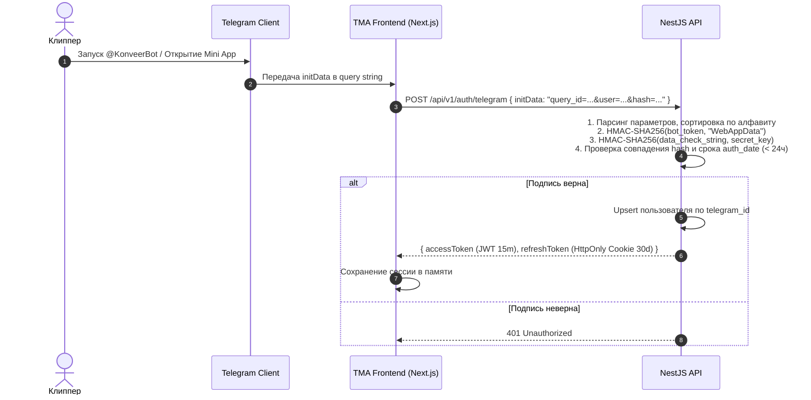

# Архитектура Аутентификации (Authentication)

Документ описывает механизмы подтверждения личности пользователей платформы Konveer через Telegram Mini App и Web-кабинет.

---

## 1. Авторизация клипперов через Telegram Mini App (TMA)

Для клипперов полностью устранены формы регистрации, логины и пароли:

---

## 2. Авторизация рекламодателей и администраторов в Web-кабинете
- **Рекламодатели**: Вход по Email + Одноразовый код (Magic Link / OTP) в Telegram-бот либо SMS + опционально вход через Telegram Login Widget.
- **Администраторы**: Вход строго по связке Логин/Пароль + Обязательная двухфакторная аутентификация (TOTP Google Authenticator) + привязка к белому списку IP-адресов VPN офиса.

---

## Связанные документы
- [[08 - ARCHITECTURE/Authorization (RBAC)|Авторизация (RBAC)]]
- [[05 - INTEGRATIONS/Telegram Bot API|Интеграция с Telegram Bot API]]
- [[08 - ARCHITECTURE/Security Architecture|Архитектура безопасности]]
