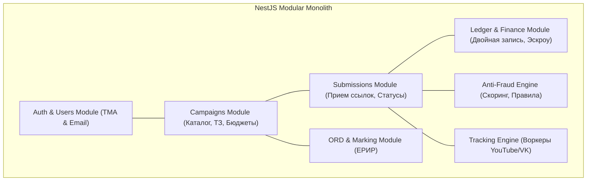

---
title: Архитектура бэкенда и выбор стека (Backend Architecture & Stack)
type: architecture
status: active
priority: critical
created: 2026-10-31
updated: 2026-10-31
tags:
  - konveer
  - backend
  - nestjs
  - tech-stack
---

# ⚙️ Архитектура бэкенда и обоснование технологического стека

## 1. Архитектурный паттерн: Модульный монолит (Modular Monolith)

> [!IMPORTANT]
> **Принцип:** Категорический отказ от микросервисов на стадии запуска.  
> Преждевременный переход к микросервисам (gRPC, distributed transactions, network latency) убивает скорость разработки стартапа. Система строится как **единый модульный монолит с жесткими границами контекстов (Domain-Driven Design)**, который при необходимости легко разделяется на отдельные сервисы без переписывания бизнес-логики.

---

## 2. Сравнение и обоснование серверного стека

| Стек | Плюсы | Минусы | Вердикт |
| :--- | :--- | :--- | :---: |
| **Node.js (NestJS + TypeScript)** | Единый язык с фронтендом, богатая экосистема (BullMQ, Prisma), строгая DI-модульная архитектура, идеальная поддержка асинхронного I/O для тысяч HTTP-запросов к соцсетям. | Чуть медленнее чистого Go на тяжелых CPU-вычислениях. | 🟢 **ВЫБРАН КАК ОСНОВНОЙ** |
| **Python (FastAPI + Celery)** | Отличные библиотеки для парсинга и ML/OCR. | Celery сложнее и тяжелее BullMQ; разрыв стека с TypeScript-фронтендом. | 🟡 Резерв для OCR/ML модулей |
| **Go (Golang)** | Высочайшая скорость, низкое потребление RAM. | Медленная скорость прототипирования на старте, беднее ORM-экосистема. | 🔴 Избыточно для MVP |

---

## 3. Выбор ORM и работы с данными: Prisma + Kysely

* **Prisma ORM:** Используется для стандартных CRUD-операций, декларативной схемы базы данных (`schema.prisma`), автоматических миграций и типобезопасности TypeScript.
* **Kysely (Type-safe SQL Query Builder):** Используется для модуля **Ledger**, где требуются сложные финансовые агрегации, строгие транзакции с уровнем `SERIALIZABLE` и блокировками `FOR UPDATE`.

Связанные документы:
- [[08 - ARCHITECTURE/System Architecture & C4 Diagrams|Системная архитектура]]
- [[08 - ARCHITECTURE/Database Architecture & ERD|Схема БД]]
- [[08 - ARCHITECTURE/Queue Architecture & Background Workers|Очереди BullMQ]]
