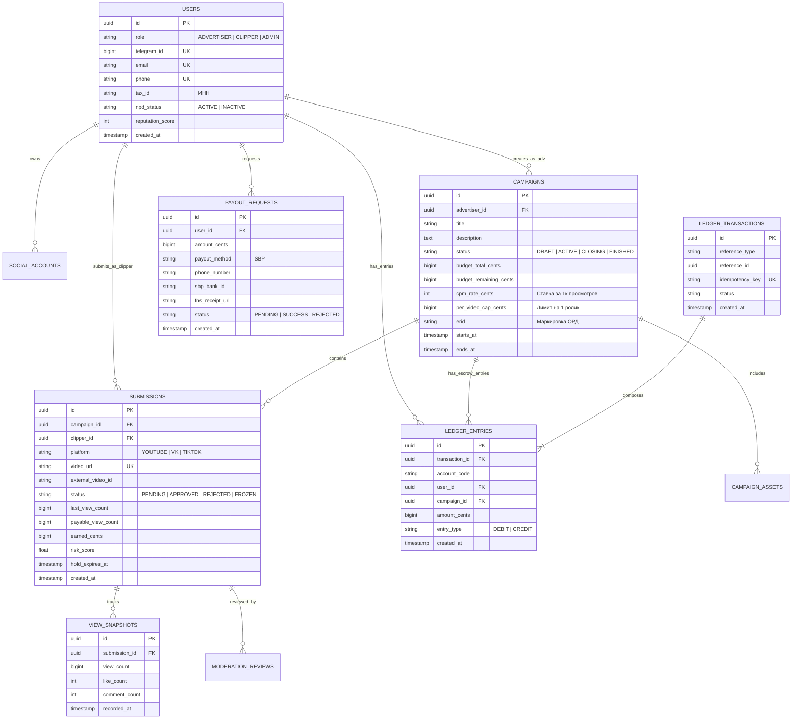

# Диаграмма Сущностей и Связей Базы Данных (Database ERD)

Документ содержит полную Mermaid Entity-Relationship диаграмму реляционной модели данных платформы Konveer.

---

## 1. Схема сущностей (Mermaid ERD)

---

## Связанные документы
- [[08 - ARCHITECTURE/Database Architecture|Архитектура базы данных]]
- [[04 - FINANCE/Ledger Architecture|Архитектура Ledger]]
- [[02 - PRODUCT/Roles, Permissions & System States|Системные роли и состояния]]
