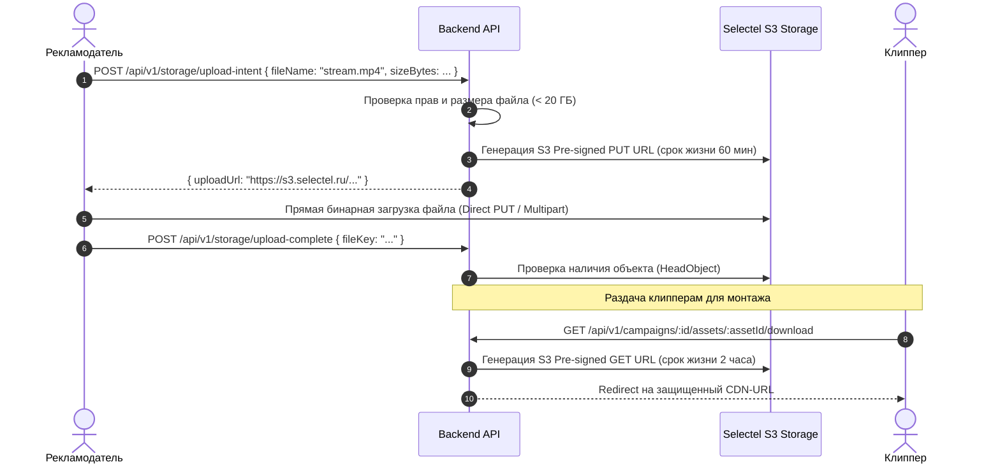

# Архитектура Файлового Хранилища (File Storage S3)

Документ регламентирует принципы хранения, загрузки и раздачи медиаконтента платформы Konveer.

---

## 1. Прямая загрузка через Pre-signed URLs (Direct Upload)

Для предотвращения перегрузки бэкенда терабайтами тяжелого видео исходников (стримов 1080p/4K) загрузка осуществляется напрямую в S3:

---

## 2. Структура бакетов и политики жизненного цикла (Lifecycle Policies)
- `konveer-campaign-raw`: Приватный бакет исходников. Правило жизненного цикла: автоматическое удаление тяжелых исходников через 30 дней после финализации кампании для оптимизации расходов на хранение.
- `konveer-public-assets`: Публичный бакет для логотипов кампаний, аватаров и статических изображений (раздача через кэширующий CDN).
- `konveer-legal-archives`: Архивы чеков ФНС, договоров и актов (холодное хранение, бессрочно).

---

## Связанные документы
- [[05 - INTEGRATIONS/S3 Storage Providers|Провайдеры S3]]
- [[02 - PRODUCT/Advertiser Cabinet Specification|Кабинет рекламодателя]]
