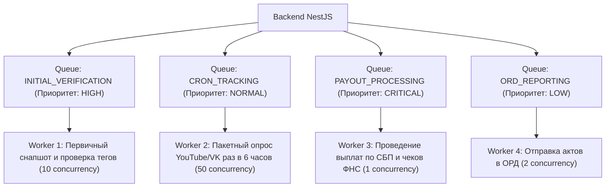

---
title: Архитектура очередей и фоновые воркеры (Queue Architecture & Workers)
type: architecture
status: active
priority: critical
created: 2026-10-31
updated: 2026-10-31
tags:
  - konveer
  - queues
  - bullmq
  - redis
  - workers
---

# ⚡ Архитектура очередей и фоновых задач (BullMQ & Redis)

## 1. Топология очередей системы

Асинхронная обработка строится на **BullMQ + Redis**. Задачи разделены на 4 изолированные очереди с разным приоритетом и политикой повторов (Retry Backoff):

---

## 2. Спецификация очереди регулярного трекинга (`CRON_TRACKING`)
* **Интервал запуска:** Каждые 6 часов.
* **Батчинг (Пакетная обработка):**
  1. Воркер выбирает из БД все сабмиты со статусом `TRACKING` (например, 2 500 видео).
  2. Группирует YouTube-ролики по 50 штук в один массив.
  3. Делает 50 пакетных запросов к `YouTube Data API v3` (расход квоты: всего 50 единиц из 10 000 доступных в сутки!).
  4. Записывает метрики в `submission_metrics_log`.
  5. Проверяет условие: если `now() >= hold_until` (прошло 72 часа), сабмит переводится в статус `ON_HOLD` и передается в модуль скоринга рисков.

Связанные документы:
- [[05 - INTEGRATIONS/YouTube Data API Integration|YouTube API]]
- [[06 - ANTI FRAUD/Fraud Detection Model & Risk Scoring|Антифрод]]
- [[08 - ARCHITECTURE/Database Architecture & ERD|Схема БД]]
