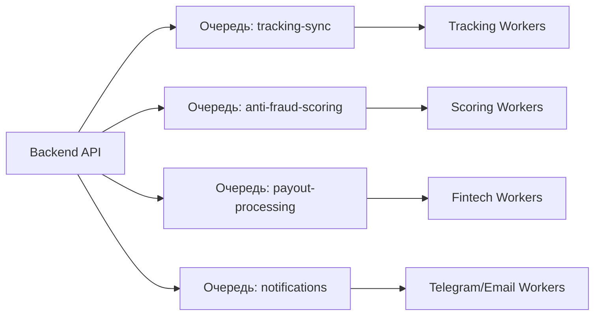

# Архитектура Очередей Задач (Queue Architecture)

Документ описывает систему асинхронной обработки задач на базе **BullMQ и Redis 7**.

---

## 1. Реестр системных очередей

Платформа использует 4 изолированные очереди с независимыми пулами воркеров:

1. **`tracking-sync`**:
   - Задача: Опрос внешних API (YouTube Data API, VK API) для обновления просмотров и лайков по активным роликам.
   - Concurrency: 10 параллельных потоков с соблюдением Rate Limits API.
2. **`anti-fraud-scoring`**:
   - Задача: Анализ динамики $ER$, списаний платформой, расчет Risk Score.
3. **`payout-processing`**:
   - Задача: Взаимодействие со шлюзом СБП и сервисом фискализации ФНС «Мой налог».
   - Concurrency: 3 параллельных воркера (последовательная обработка для исключения банковских блокировок).
4. **`notifications`**:
   - Задача: Доставка push-сообщений в Telegram-бот и транзакционных email.

---

## 2. Политика повторов и Dead-Letter Queue (DLQ)
- Экспоненциальный откат (Exponential Backoff): `delay = 1000 * 2^attempts`.
- Максимальное число попыток: 5.
- При исчерпании попыток задача перемещается в очередь сбоев `DLQ` (Dead-Letter Queue), и генерируется алерт дежурному инженеру.

---

## Связанные документы
- [[08 - ARCHITECTURE/Background Jobs|Фоновые периодические задачи]]
- [[08 - ARCHITECTURE/Notification Architecture|Архитектура уведомлений]]
- [[05 - INTEGRATIONS/YouTube Data API|Интеграция с YouTube API]]
