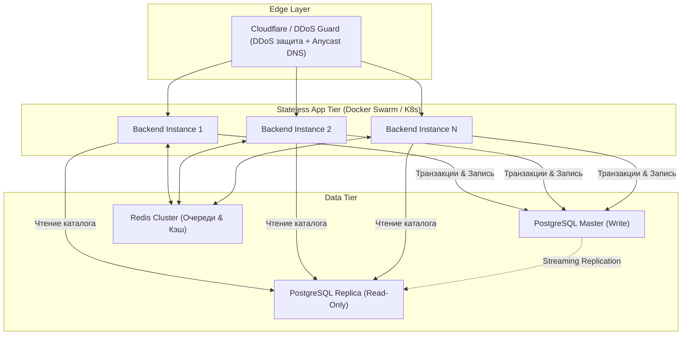

---
title: Безопасность, авторизация и масштабирование (Security & Scalability)
type: architecture
status: active
priority: high
created: 2026-10-31
updated: 2026-10-31
tags:
  - konveer
  - security
  - scalability
  - auth
---

# 🛡️ Архитектура безопасности, авторизации и масштабирования

## 1. Модель аутентификации и сессий
* **Клипперы (TMA):** Stateless JWT токены (Access Token живет 15 минут, Refresh Token хранится в зашифрованном виде в Redis с TTL 30 дней). Привязка к `telegram_id`.
* **Рекламодатели (Web):** Cookie-based сессии с флагами `HttpOnly`, `Secure`, `SameSite=Strict`. Защита от CSRF через Double Submit Cookie / Custom Header (`X-CSRF-Token`).
* **Администраторы:** Доступ к `/admin` закрыт через IP Whitelist на уровне NGINX + обязательная аппаратная или программная 2FA (RFC 6238 TOTP).

---

## 2. Горизонтальное масштабирование (Scaling Roadmap)

* **Stateless Backend:** Экземпляры NestJS не хранят состояние в памяти (все сессии в Redis). При росте трафика поднимаются новые контейнеры за 10 секунд.
* **Read-Replica:** Тяжелые запросы аналитики для десктопного дашборда рекламодателя направляются на реплику PostgreSQL, не нагружая мастер-базу, проводящую транзакции Ledger.

Связанные документы:
- [[08 - ARCHITECTURE/System Architecture & C4 Diagrams|Системная архитектура]]
- [[08 - ARCHITECTURE/Database Architecture & ERD|Схема БД]]
- [[04 - FINANCE/Financial Security & Invariants|Финансовые инварианты]]
