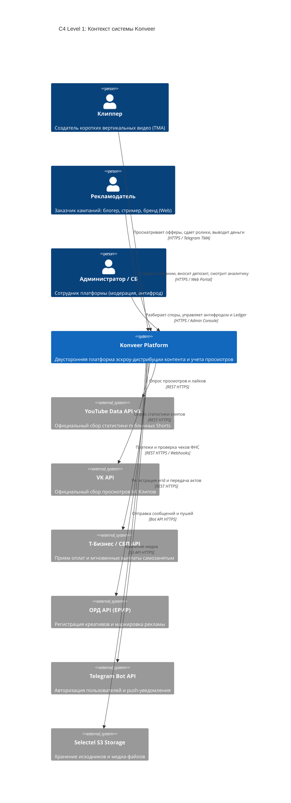
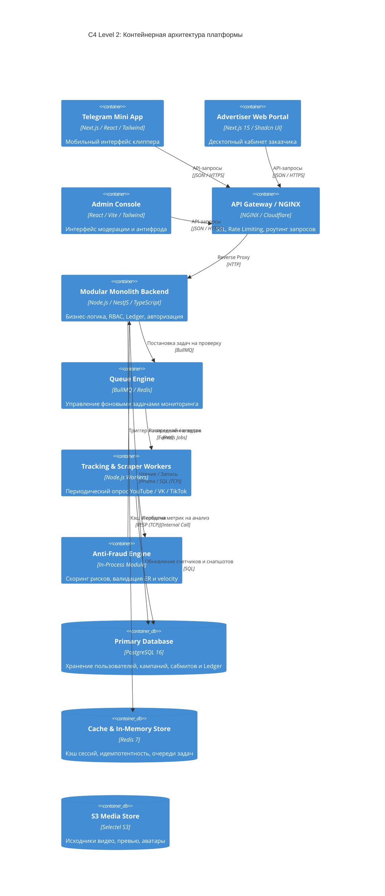

---
title: Системная архитектура и C4 диаграммы (System Architecture & C4)
type: architecture
status: active
priority: critical
created: 2026-10-31
updated: 2026-10-31
tags:
  - konveer
  - architecture
  - c4-model
  - diagrams
---

# 🏗️ Системная архитектура и диаграммы C4 (System Architecture)

## 1. C4 Контекстная диаграмма (Context Diagram — Level 1)

---

## 2. C4 Диаграмма контейнеров (Container Diagram — Level 2)

Связанные документы:
- [[08 - ARCHITECTURE/Backend Architecture & Tech Stack Selection|Выбор технологического стека]]
- [[08 - ARCHITECTURE/Database Architecture & ERD|Схема БД]]
- [[08 - ARCHITECTURE/Queue Architecture & Background Workers|Архитектура очередей]]
