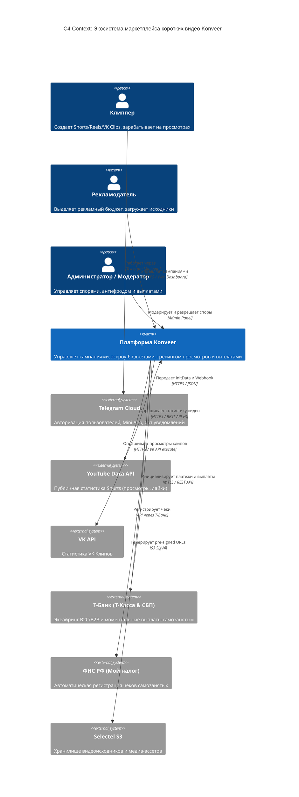

# Общая Системная Архитектура Платформы (System Architecture)

Документ описывает глобальное устройство платформы **Konveer** с использованием модели C4 (Context, Containers).

---

## 1. Системный контекст (C4 Context Diagram)

---

## 2. Архитектурный стиль: Модульный монолит (Modular Monolith)

Для стадии MVP и масштабирования до 100 000 активных пользователей выбран **Модульный Монолит** вместо микросервисов:
- Единая кодовая база на TypeScript / Node.js (NestJS или Fastify).
- Строгая изоляция модулей по принципам Domain-Driven Design (DDD):
  - `modules/auth`: Авторизация TMA, JWT, RBAC.
  - `modules/campaigns`: Жизненный цикл рекламных заданий и эскроу.
  - `modules/submissions`: Учет видео, дедупликация, метаданные.
  - `modules/tracking`: Фоновый опрос API YouTube / VK.
  - `modules/anti-fraud`: Скоринг, расчет ER, детекция ботов.
  - `modules/ledger`: Двойная запись, балансы, финансовые инварианты.
  - `modules/payouts`: Интеграция со шлюзом СБП и ФНС.
- Межмодульное взаимодействие строго через типизированные интерфейсы (Services/Facades) и события (In-process Event Bus / Redis Streams).

---

## Связанные документы
- [[08 - ARCHITECTURE/Backend Architecture|Архитектура бэкенда]]
- [[08 - ARCHITECTURE/Frontend Architecture|Архитектура фронтенда]]
- [[08 - ARCHITECTURE/Database Architecture|Архитектура базы данных]]
- [[08 - ARCHITECTURE/Deployment Architecture|Архитектура развертывания]]
