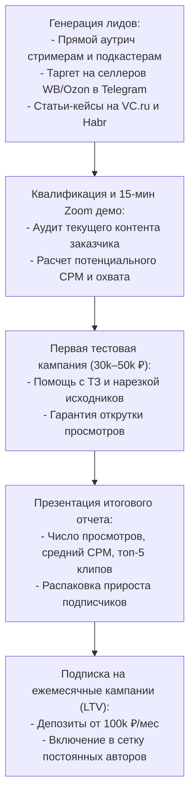

---
title: Привлечение рекламодателей и воронка B2B (Advertiser B2B Funnel)
type: marketing
status: active
priority: critical
created: 2026-10-31
updated: 2026-10-31
tags:
  - konveer
  - b2b
  - sales-funnel
  - marketing
---

# 🏢 Привлечение рекламодателей и воронка B2B продаж

## 1. Архитектура B2B воронки продаж



---

## 2. Скрипт холодного оффера для стримеров и блогеров (Outreach Script)

```text
Тема: Идея как получить +500k просмотров в Shorts из твоих стримов (без геморроя с монтажерами)

Привет, [Имя]! Слежу за твоими стримами по [Игра/Тематика]. 
Заметил, что у тебя крутой контент, но нарезки в Shorts и TikTok выходят редко.

У нас площадка, где 500+ независимых клипперов берут твои стримы, сами нарезают лучшие моменты и выкладывают в сеть с ссылкой на твой канал. 
Ты платишь ТОЛЬКО за реальные подтвержденные просмотры (по 10 копеек за просмотр). Если ролик не набрал — ты ничего не платишь.

Хотим взять твой вчерашний стрим в пилотную кампанию на 25 000 ₽. Мы сами подготовим ТЗ и дадим гарантию на 250 000 просмотров.
Интересно глянуть, как это работает?
```

---

## 3. Как обеспечить повторные кампании (Repeat Rate $> 60\%$)

1. **Библиотека готового контента:** Рекламодатель получает право бесплатно скачивать все смонтированные клипперами ролики в высоком качестве и выкладывать в свои официальные соцсети.
2. **Аналитика переходов по ссылкам:** Предоставление тепловой карты кликов по UTM-ссылкам в закрепленных комментариях с расчетом стоимости привлеченного подписчика (CPA).
3. **Прогрессивная скидка на комиссию (Volume Discounts):**
   * Оборот от 300 000 ₽/мес $\rightarrow$ комиссия платформы снижается с 20% до 16%.
   * Оборот от 1 000 000 ₽/мес $\rightarrow$ комиссия 12% + персональный контент-редактор.

Связанные документы:
- [[01 - BUSINESS/Target Audience & Personas|Целевая аудитория B2B]]
- [[09 - MARKETING/Go-To-Market Strategy|GTM стратегия]]
