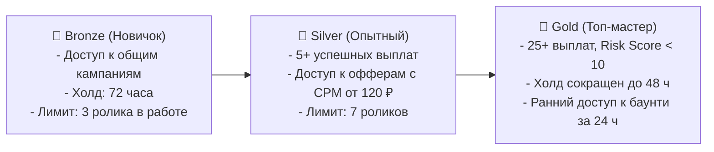

---
title: Привлечение авторов и построение комьюнити (Creator Acquisition)
type: marketing
status: active
priority: high
created: 2026-10-31
updated: 2026-10-31
tags:
  - konveer
  - creators
  - community
  - viral
---

# 👥 Привлечение клипперов и комьюнити-менеджмент

## 1. Каналы привлечения клипперов

| Канал | Стоимость привлечения (CAC) | Конверсия в первый сабмит | Механика |
| :--- | :---: | :---: | :--- |
| **Шортсы о заработке на клипперстве (UGC-петля)** | **0 ₽** (Органика) | 18% – 25% | Ролики в TikTok/Shorts: «Как я заработал 14 000 ₽ за неделю, нарезая стримы в CapCut» с показом выводов на карту СБП. |
| **Посевы в пабликах по CapCut и монтажу** | 40 – 70 ₽ за переход | 12% – 15% | Рекламные посты в каналах с пресетами, звуками и паками для монтажеров. |
| **Реферальная программа клипперов** | 3% от выплат (CPA) | 35% (по рекомендации) | Клиппер скидывает ссылку одногруппникам: «Тут реально платят за просмотры». |
| **Тематические Discord-серверы и чаты геймеров** | 0 ₽ (Партизанский маркетинг) | 10% | Обсуждение в чатах стримеров: «Где найти нарезки стримера X и заработать». |

---

## 2. Геймификация и удержание (Creator Retention)

Чтобы клипперы не уходили после одной кампании, внедрена **система рангов и достижений (Badges & Tiers)**:

### Еженедельные денежные кубки (Leaderboards):
Каждое воскресенье в 23:59 топ-3 клиппера платформы по суммарным просмотрам за неделю получают денежные гранты от сервиса:
* 1 место: **+10 000 ₽** на баланс к выводу.
* 2 место: **+5 000 ₽**.
* 3 место: **+2 500 ₽**.
Это стимулирует соревновательный азарт и круглосуточный мониторинг новых кампаний.

Связанные документы:
- [[09 - MARKETING/Viral Growth Loops & Referral System|Виральные петли]]
- [[02 - PRODUCT/Clipper Cabinet Specification|Кабинет клиппера]]
