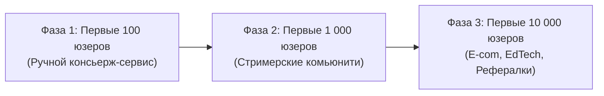

---
title: Go-To-Market Стратегия (GTM Strategy)
type: marketing
status: active
priority: critical
created: 2026-10-31
updated: 2026-10-31
tags:
  - konveer
  - marketing
  - gtm
  - strategy
---

# 🚀 Go-To-Market (GTM) Стратегия запуска в РФ

## 1. Фазы масштабирования платформы (100 $\rightarrow$ 1 000 $\rightarrow$ 10 000 пользователей)

---

## 2. Детальный план по фазам

### Фаза 1: Первые 100 пользователей (Private Alpha / Ручной режим)
* **Цель:** Провести первые 5 кампаний без багов в расчете просмотров и выплатить первые 100 000 ₽.
* **Привлечение спроса (Рекламодатели):**
  * Прямой фаундерский аутрич (Cold Outreach): пишем 30 растущим стримерам Twitch (онлайн 500–1 500 человек) и 10 авторам подкастов.
  * Оффер: *«Мы бесплатно настроим и проведем вашу кампанию шортсов. Вы платите только 25 000 ₽ депозита, который уйдет клипперам по ставке 100 ₽ за 1k views. Если не наберем 250 000 просмотров — вернем остаток»*.
* **Привлечение предложения (Клипперы):**
  * Публикация объявлений в профильных Telegram-чатах по монтажу (`@ru_capcut`, `@premiere_freelance`, паблики нарезчиков).
  * Ручной инвайт первых 50 клипперов в закрытый Telegram-канал.

### Фаза 2: Первые 1 000 пользователей (Closed Beta)
* **Цель:** 20 активных кампаний ежемесячно, 500+ активных клипперов.
* **Привлечение спроса:**
  * Публикация кейс-стади первого этапа: *«Как подкаст X получил 1.2 млн просмотров в Shorts за 40 000 ₽ через распределенную сеть авторов»*. Размещение на VC.ru и в Telegram-каналах про маркетинг.
  * Партнерство с агентствами по инфлюенс-маркетингу (предлагаем им закрывать KPI клиентов по шортсам с 10% партнерской скидкой).
* **Привлечение предложения:**
  * Запуск двусторонней реферальной программы клипперов: *«Приведи друга-монтажера — получай 3% от суммы всех его выплат пожизненно за счет платформы»*.

### Фаза 3: Первые 10 000 пользователей (Public Scale)
* **Цель:** 150+ кампаний в месяц, оборот GMV от 7.5 млн ₽/мес.
* **Привлечение спроса:**
  * Таргетированная реклама на селлеров Wildberries и Ozon с оффером: *«Внешний трафик на артикулы WB по 10 копеек за просмотр»*.
  * Автоматический онбординг юрлиц с ЭДО и закрывающими документами.
* **Привлечение предложения:**
  * Вирусные челленджи в TikTok и VK Клипах с призовыми фондами: конкурсы на лучший мемный монтаж месяца.

Связанные документы:
- [[09 - MARKETING/Solving Chicken-and-Egg Problem|Проблема курицы и яйца]]
- [[09 - MARKETING/Creator Acquisition & Community Building|Привлечение авторов]]
- [[09 - MARKETING/Advertiser Acquisition & B2B Sales Funnel|Воронка B2B]]
