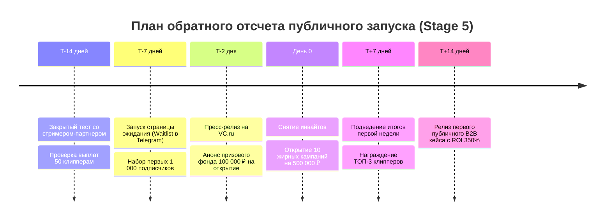

# 🚀 Кампания публичного запуска платформы (Launch Sequence)

## 1. Фазированный план запуска (Launch Timeline)

---

## 2. Акция первого дня: «Двойной старт»
* **Для рекламодателей:** Пополни депозит на 50 000 ₽ в первую неделю — получи +10 000 ₽ к призовому пулу клипперов за счет платформы.
* **Для клипперов:** Первые 100 авторов, сдавшие видео с просмотрами $> 5\,000$, получают мгновенный бонус **+500 ₽** к первому выводу на карту.

Связанные документы:
- [[10 - ROADMAP/Stage 5 & 6 — Public Launch & Scaling|Этап запуска Stage 5]]
- [[09 - MARKETING/Go-To-Market Strategy|GTM стратегия]]
