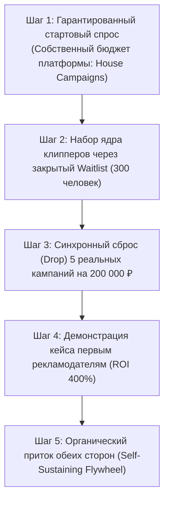

---
title: Решение проблемы курицы и яйца (Solving Chicken-and-Egg)
type: marketing
status: active
priority: critical
created: 2026-10-31
updated: 2026-10-31
tags:
  - konveer
  - chicken-and-egg
  - liquidity
  - marketplace-dynamics
---

# 🥚 Решение проблемы курицы и яйца в двухстороннем маркетплейсе

## 1. Главный парадокс стартапа
* Если на платформу первыми придут **клипперы**, а каталоги кампаний будут пустыми $\rightarrow$ клипперы разочаруются и удалят бота за 3 минуты.
* Если на платформу первыми придут **рекламодатели**, а клипперов не будет $\rightarrow$ за 48 часов никто не смонтирует ролики, рекламодатели заберут депозит и больше никогда не вернутся.

---

## 2. Стратегия последовательной синхронизации (Sequential Matchmaking)

---

## 3. Четыре тактических инструмента для холодного старта

### 1. Собственные внутренние кампании (House Campaigns / Seed Funding)
* Платформа выделяет собственный бюджет (50 000 ₽) на промо-кампанию самого Konveer.
* Задание клипперам: *«Нарежь смешные видосы о том, как школьники зарабатывают на шортсах / как блогеры ищут монтажеров, со ссылкой на нашего бота»*.
* **Двойной эффект:**
  1. Каталог не пустой — клипперы сразу видят деньги и начинают монтировать.
  2. Эти ролики сами привлекают тысячи новых клипперов и рекламодателей со всего интернета абсолютно бесплатно!

### 2. Принцип «Subsidize the Supply» (Субсидирование авторов)
* Клипперам намного сложнее ждать. Поэтому на старте за первые 3 одобренных ролика клиппер получает приветственный бонус **+300 ₽** поверх ставки просмотров. Это стимулирует сделать первый сабмит в течение 2 часов после входа.

### 3. Лист ожидания и порционный доступ (Waitlist Drops)
* Не открывать двери сразу для всех 10 000 клипперов.
* Пускать клипперов пачками по 50 человек строго под объем открывающихся бюджетов. Это создает ощущение элитарности, закрытого клуба и дефицита мест.

### 4. Консьерж-гарантия для первых стримеров (Zero-Risk Offer)
* Фаундер лично договаривается со стримером: *«Дай нам запись своего стрима. Если мы за неделю не сделаем тебе 500 000 просмотров нарезками — мы полностью возвращаем тебе депозит из своих денег»*. Заказчик ничем не рискует.

Связанные документы:
- [[09 - MARKETING/Go-To-Market Strategy|GTM стратегия]]
- [[01 - BUSINESS/Business Risks|Бизнес-риски]]
- [[10 - ROADMAP/Stage 1 — Validation & Concierge MVP|Этап валидации]]
