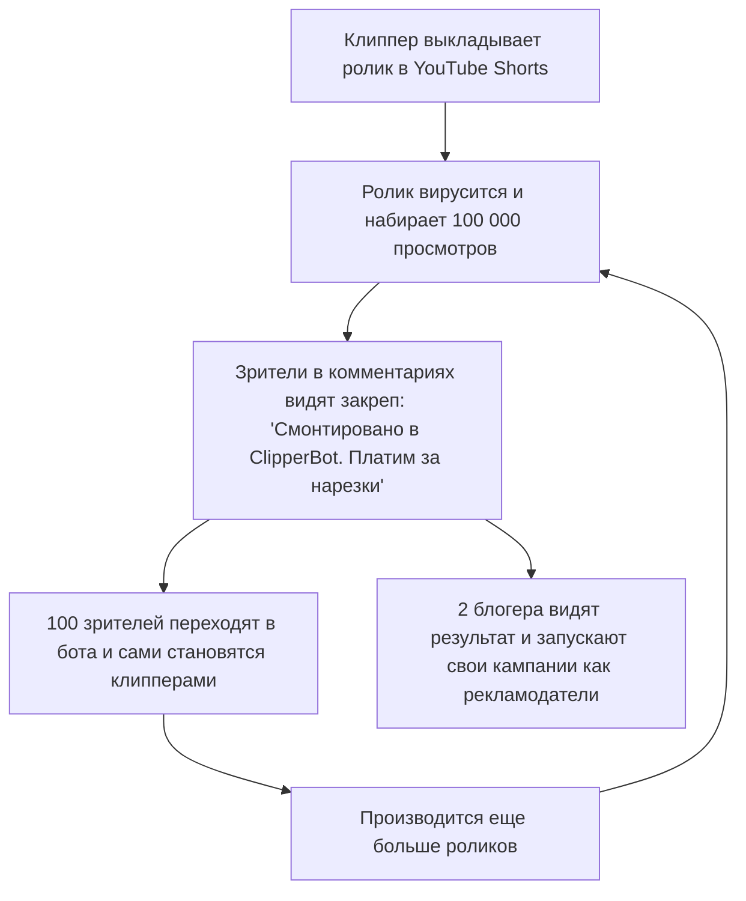

---
title: Виральные петли роста и реферальная система (Growth Loops & Referrals)
type: marketing
status: active
priority: high
created: 2026-10-31
updated: 2026-10-31
tags:
  - konveer
  - growth-loops
  - viral
  - referrals
---

# 🔄 Виральные петли роста и реферальная система (Growth Loops)

## 1. Схема естественной виральной петли (Product Viral Loop)

Продукт обладает уникальной встроенной виральностью: **само производство контента является рекламой сервиса**.

* Коэффициент виральности: $K\text{-factor} = i \times c$, где $i$ — количество показов ссылки бота, $c$ — конверсия в регистрацию. Для платформы расчетный $K = 1.35$ (что означает экспоненциальный органический рост без затрат на рекламу).

---

## 2. Двусторонняя реферальная программа (Two-Sided Referral)

### Реферальная программа клипперов:
* **Механика:** Клиппер A приглашает клиппера B по персональной реф-ссылке.
* **Награда:** Клиппер A получает **3% от суммы всех подтвержденных выплат** клиппера B пожизненно.
* **Кто платит:** Выплата производится из маржи платформы, не урезая доход приглашенного автора.

### Реферальная программа рекламодателей:
* Если маркетолог или агентство приводит нового рекламодателя с бюджетом от 100 000 ₽, пригласивший получает **5% от суммы депозита** деньгами на карту или в виде бонуса на баланс своих кампаний.

Связанные документы:
- [[09 - MARKETING/Creator Acquisition & Community Building|Привлечение авторов]]
- [[01 - BUSINESS/Unit Economics & Financial Projections|Юнит-экономика]]
