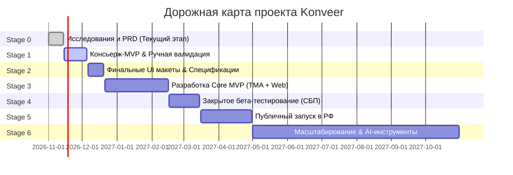

---
title: Главная дорожная карта (Master Roadmap & Execution)
type: roadmap
status: active
priority: critical
created: 2026-10-31
updated: 2026-10-31
tags:
  - konveer
  - roadmap
  - execution
  - planning
---

# 🗺️ Мастер-роадмап реализации проекта (Master Roadmap)

## 1. Сквозная временная шкала этапов (Gantt-схема)

---

## 2. Сводная таблица стадий проекта

| Этап | Название | Длительность (оценка) | Главная цель | Выходной артефакт (Exit Gate) |
| :---: | :--- | :---: | :--- | :--- |
| **Stage 0** | [[10 - ROADMAP/Stage 0 — Research & Feasibility|Research & Feasibility]] | 2 недели | Системный анализ, PRD, валидация API и юридических схем | Полная база знаний в Obsidian, реестр рисков |
| **Stage 1** | [[10 - ROADMAP/Stage 1 — Validation & Concierge MVP|Validation & Concierge MVP]] | 3 недели | Ручной прогон первой кампании без софта в Telegram | 1 реальный клиент, 100k+ просмотров, подтверждение CPM |
| **Stage 2** | [[10 - ROADMAP/Stage 2 — Product Design & Specs|Product Design & Specs]] | 2 недели | Figma UI Kit, контракты API, финальная ERD | Кликабельный прототип TMA и Web |
| **Stage 3** | [[10 - ROADMAP/Stage 3 — MVP Development|MVP Development]] | 7–8 недель | Программирование монолита, TMA, Web, интеграция YouTube/VK | Рабочий стенд в Dev/Staging окружении |
| **Stage 4** | [[10 - ROADMAP/Stage 4 — Closed Beta & Hardening|Closed Beta & Hardening]] | 4 недели | Тестирование финансов, СБП выплат и антифрода на 300 авторах | 500 000 ₽ обработанного GMV, 0 критических багов |
| **Stage 5** | [[10 - ROADMAP/Stage 5 & 6 — Public Launch & Scaling|Public Launch]] | 6 недель | Открытый маркетинг, снятие инвайтов, работа с B2B | 50 активных кампаний, выход на операционную безубыточность |
| **Stage 6** | [[10 - ROADMAP/Stage 5 & 6 — Public Launch & Scaling|Scaling & AI Tools]] | Постоянно | AI-репурпосинг видео, интеграция TikTok/Reels, экспансия в СНГ | 35 млн ₽ месячного GMV |

Связанные документы:
- [[00 - HOME/Project Status|Текущий статус]]
- [[11 - TASK MANAGEMENT/Task Management System & WBS|Система управления задачами]]
