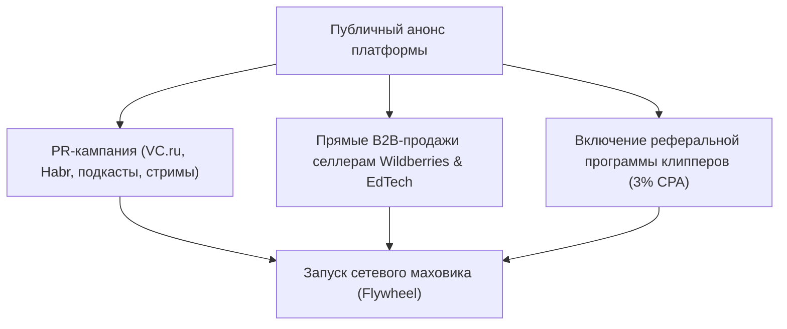
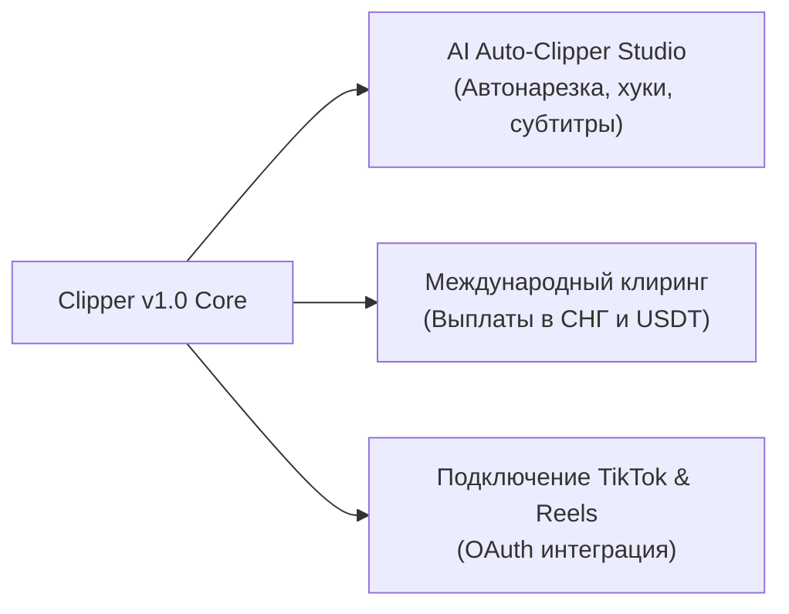

---
title: Stage 5 и 6 — Публичный запуск и масштабирование (Launch & Scaling)
type: roadmap
status: planned
priority: high
created: 2026-10-31
updated: 2026-10-31
tags:
  - konveer
  - roadmap
  - stage-5
  - stage-6
  - scaling
---

# 🚀 Stage 5 & 6 — Public Launch & Scaling (Публичный запуск и масштабирование)

## 1. Stage 5: Публичный запуск в РФ (Месяцы 5–7)

### Паспорт этапа
* **Цель:** Снятие ограничений по инвайтам, открытый старт регистрации в Telegram Mini App, развертывание сквозной B2B-воронки и выход на операционную самоокупаемость.
* **Целевой GMV:** 5 000 000 ₽ / месяц (Выручка платформы: 1 000 000 ₽ / месяц).

### Ключевые задачи Stage 5:
- [ ] Публикация серии экспертных статей на VC.ru о перевороте в шорт-форм маркетинге и кейсе Мелстроя.
- [ ] Запуск автоматизированной интеграции с **ОРД-А / ОРД VK** для промышленной маркировки рекламы юрлиц.
- [ ] Включение платной подписки **Clipper PRO** (390 ₽/мес) с ранним доступом к новым кампаниям.
- [ ] Найм 2 специалистов службы поддержки и 1 риск-офицера на полный рабочий день.
- [ ] Оптимизация кэширования в Redis для поддержки до 20 000 активных сессий в TMA одновременно.

---

## 2. Stage 6: Масштабирование и AI-инструменты (Месяцы 8–18)

### Паспорт этапа
* **Цель:** Трансформация из биржи в технологическую AI-экосистему короткого контента, экспансия в страны СНГ и выход на оборот 35 000 000 ₽ в месяц.

### Ключевые инновации Stage 6:
1. **Встроенный AI-комбайн для клипперов (Clipper AI):**
   * Интеграция AI-пайплайна (Whisper + Llama/Gemini): автоматический поиск виральных моментов длинного стрима, автогенерация стильных анимированных субтитров и кадрирование спикеров 9:16.
   * Клиппер может собрать черновик клипа прямо внутри браузера за 60 секунд.
2. **Мультивалютный клиринг и экспансия в СНГ:**
   * Открытие юридического присутствия в Казахстане (МФЦА) для легальной работы со стримерами и брендами стран СНГ.
   * Подключение выплат на карты банков Казахстана (Kaspi), Беларуси и в крипто-стейблкоинах (USDT TRC-20 / TON).
3. **Официальный TikTok Display API и Reels OAuth:**
   * Прохождение официального аудита приложений в TikTok for Developers и Meta Developers.
   * Подключение авторов через прямой OAuth вход с автоматическим считыванием внутренней статистики удержания и аудитории.

Связанные документы:
- [[10 - ROADMAP/Master Roadmap & Phased Execution|Мастер-роадмап]]
- [[09 - MARKETING/Go-To-Market Strategy|GTM стратегия]]
- [[01 - BUSINESS/Unit Economics & Financial Projections|Финансовые сценарии]]
