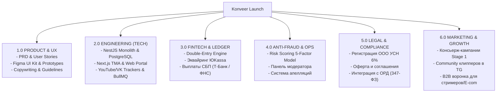
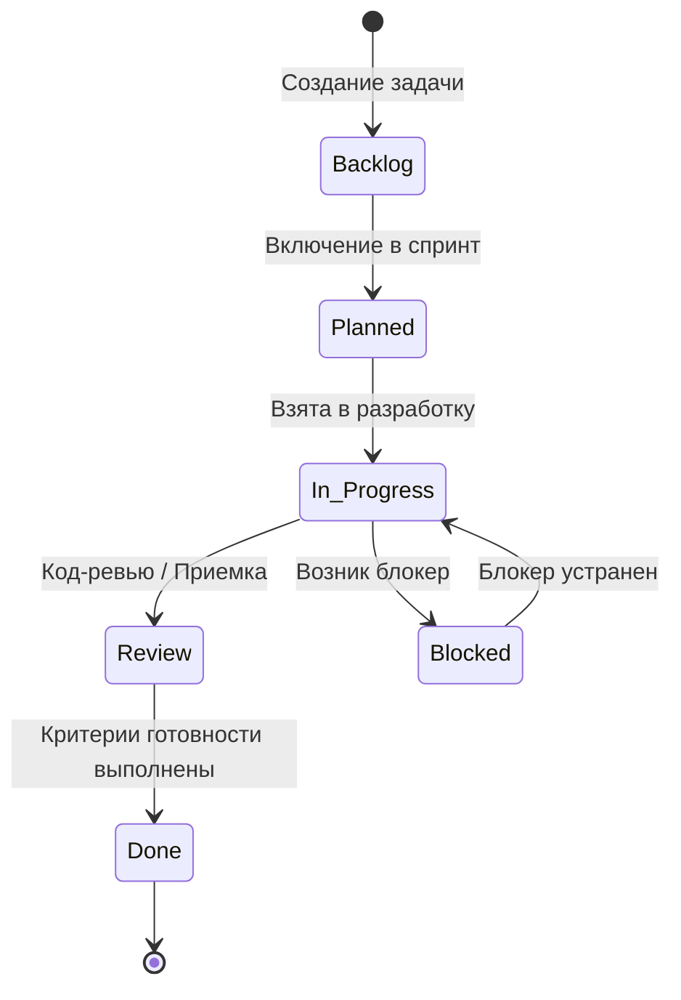

---
title: Система управления задачами и WBS (Task Management & WBS)
type: task-management
status: active
priority: critical
created: 2026-10-31
updated: 2026-10-31
tags:
  - konveer
  - tasks
  - wbs
  - management
---

# 📋 Система управления задачами и Work Breakdown Structure (WBS)

## 1. Архитектура Work Breakdown Structure (WBS)

Проект декомпозирован на 6 сквозных операционных потоков (Workstreams):

---

## 2. Модель статусов и жизненный цикл задачи

Каждая задача проходит строгий цикл смены состояний:

### Статусы:
* `Backlog` — Задача зафиксирована в бэклоге, ожидает планирования.
* `Planned` — Задача оценена и назначена на текущий рабочий цикл.
* `In Progress` — Находится в активной работе у ответственного.
* `Review` — Задача реализована, проходит тестирование, аудит безопасности или приемку Product Owner.
* `Blocked` — Работа остановлена из-за внешней зависимости (указывается `blocked_by: TSK-XXX`).
* `Done` — Все Acceptance Criteria выполнены, артефакт в проде или в базе знаний.

---

## 3. Модель приоритетов

| Приоритет | Метка | Регламент реакции | Описание |
| :--- | :---: | :---: | :--- |
| **Critical** | `🔴 Critical` | Немедленно | Блокирует запуск, несет финансовые риски (Ledger, антифрод, безопасность). |
| **High** | `🟠 High` | Текущий спринт | Ключевая функциональность MVP (TMA экраны, API парсеры). |
| **Medium** | `🟡 Medium` | По плану | Вспомогательные функции, улучшение интерфейса, второстепенные метрики. |
| **Low** | `🟢 Low` | При наличии ресурса | Косметические правки, оптимизации, расширенные анимации. |

Связанные документы:
- [[11 - TASK MANAGEMENT/Sprint Backlog & Task Registry|Реестр задач и Бэклог]]
- [[10 - ROADMAP/Master Roadmap & Phased Execution|Мастер-роадмап]]
