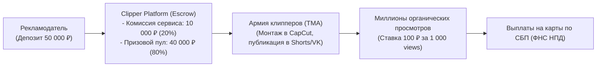
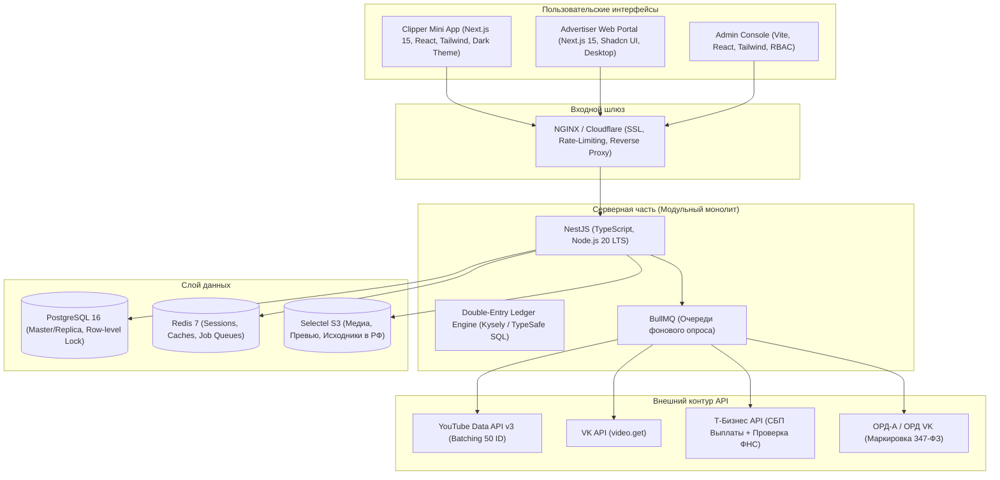
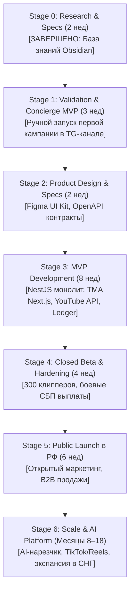

---
title: Финальный архитектурный и бизнес-чертеж проекта (Final Project Blueprint)
type: blueprint
status: approved
priority: critical
created: 2026-10-31
updated: 2026-10-31
tags:
  - konveer
  - blueprint
  - master-document
  - architecture
  - startup
---

# 🏆 FINAL PROJECT BLUEPRINT: KONVEER
## Консолидированный проект стартапа, бизнес-модели, технической и финансовой архитектуры

> [!IMPORTANT]
> **Назначение документа:** Настоящий документ является генеральным мастер-планом проекта **Konveer**. Он объединяет все ключевые решения, инженерные спецификации, финансовые формулы, юридические регламенты и дорожную карту запуска. Любой разработчик, дизайнер, маркетолог или инвестор, присоединяющийся к проекту, должен начать погружение с этого документа.

---

## 1. Исполнительное резюме (Executive Summary)

* **Продукт:** Двусторонний технологический маркетплейс-эскроу короткого вертикального видео (YouTube Shorts, VK Клипы, TikTok, Instagram Reels).
* **Бизнес-тезис:** «Продажа лопат во время золотой лихорадки шорт-видео». Рекламодатели (стримеры, блогеры, e-commerce бренды с Wildberries/Ozon, EdTech) получают миллионы дешевых органических просмотров за счет распределенной армии авторов. Клипперы (студенты, начинающие монтажеры, пользователи CapCut) получают простой и честный способ заработка на создании клипов прямо со смартфона без портфолио.
* **Главный источник дохода:** 20% комиссия (Take Rate) с рекламного депозита заказчика.
* **Рынок запуска:** Российская Федерация (с соблюдением 347-ФЗ о маркировке рекламы и выплат самозанятым по 422-ФЗ через СБП).
* **Интерфейс авторов:** **Telegram Mini App (TMA)** — моментальный онбординг без логинов и паролей, бесплатные push-уведомления.
* **Интерфейс рекламодателей:** **Web Portal (Next.js 15)** — дашборд аналитики, конструктор кампаний, ЭДО и закрывающие документы для юрлиц.

---

## 2. Архитектура потоков ценности и Юнит-экономика

### Базовый юнит кампании (50 000 ₽ GMV):
* **Валовый оборот (GMV):** 50 000 ₽ (100.0%)
* **Выплаты клипперам (Bounty Pool):** 40 000 ₽ (80.0%) $\rightarrow$ генерирует **~400 000 подтвержденных просмотров** по ставке 100 ₽ CPM.
* **Валовая выручка платформы:** 10 000 ₽ (20.0%)
* **Прямые расходы (COGS):**
  * Входящий интернет-эквайринг (ЮKassa / Т-Банк 2.8%): -1 400 ₽
  * Исходящие выплаты СБП самозанятым (1.5% от выплат): -600 ₽
  * API квоты, резидентные прокси и OCR: -150 ₽
  * Маркировка рекламы в ОРД (ЕРИР): -250 ₽
* **Чистая маржинальная прибыль (Contribution Margin):** **+7 600 ₽ (15.2% от GMV / 76% от валовой выручки)**.

### Финансовые сценарии на 12 месяцев:
* **Точка безубыточности:** **11 кампаний в месяц** (оборот 550 000 ₽/мес покрывает постоянные OPEX в 83 000 ₽/мес).
* **Базовый сценарий (Месяц 12):** 180 активных кампаний в месяц, месячный GMV **9 000 000 ₽**, чистая прибыль фаундеров **+1 370 000 ₽ в месяц**.
* **Оптимистичный сценарий (Месяц 12):** 450 кампаний в месяц, месячный GMV **33 750 000 ₽**, чистая прибыль **+6 200 000 ₽ в месяц**.

---

## 3. Технологический стек и Системная архитектура

---

## 4. Сравнительная матрица реализуемости API соцсетей

| Платформа | Доступность для публичных ссылок | Требуется ли OAuth автора? | Решение для платформы |
| :--- | :---: | :---: | :--- |
| **YouTube Shorts** | 🟢 **100% Официально** | ❌ НЕТ (Только API Key) | **Основной канал MVP:** пакетный опрос `videos.list` по 50 видео за 1 единицу квоты. |
| **VK Клипы** | 🟢 **100% Официально** | ❌ НЕТ (Service Access Token) | **Основной канал MVP:** метод `video.get` через суверенный российский API. |
| **TikTok** | 🟡 **Ограничено** | ⚠️ ДА (для официального API) | **Stage 4:** Микросервис парсинга `__UNIVERSAL_DATA__` через прокси + полуавтомат по скриншотам. |
| **Instagram Reels** | 🔴 **Строго заблокировано** | 🛑 ДА (Только через OAuth Meta) | **Stage 6:** Только в закрытых баунти-конкурсах либо через официальный OAuth зарубежного юрлица. |

---

## 5. Модель финтеха: Неизменяемый Ledger двойной записи

Для полного исключения риска отрицательных балансов, двойных списаний и потери денег внедрена бухгалтерская схема:
* **Инвариант Ledger:** Любое начисление — это пара дебетовой и кредитовой проводок ($\sum \text{Debit} = \sum \text{Credit}$).
* **План счетов:** `1000:BANK_CASH` (банк), `2000:ADV_DEPOSITS` (депозиты рекламодателей), `2100:CAMPAIGN_ESCROW` (эскроу пулы), `2200:CLIPPER_PENDING` (холд 72 ч), `2300:CLIPPER_AVAILABLE` (доступно к выводу), `3000:PLATFORM_REVENUE` (выручка платформы).
* **Принцип честной комиссии:** Платформа берет 20% комиссии **только с фактически открученного бюджета**. При досрочной отмене кампании неизрасходованный остаток депозита вместе с пропорциональной комиссией возвращается рекламодателю в 1 клик.

---

## 6. Система антифрода и модерации

* **72-часовой период холда:** Начисление фиксируется в статусе `PENDING`. Окончательный перевод в `AVAILABLE` происходит только на 72-й час после автоматической проверки соцсетью (алгоритмы YouTube/VK списывают ботов за 24–48 ч).
* **5-факторная модель Risk Score:**
  1. $F_1$: Аномалия Engagement Rate (если лайков меньше 1.5% от просмотров — флаг накрутки).
  2. $F_2$: Velocity Spike (мгновенный неестественный всплеск на мертвом канале).
  3. $F_3$: Drop Rate (падение счетчика просмотров $\rightarrow$ моментальный бан).
  4. $F_4$: Trust Score аккаунта клиппера.
  5. $F_5$: Перцептивный хэш контента (pHash против перезаливов чужих видео).
* **Защита авторов:** Уникальный персональный код (`#clip_USERID`) в описании ролика доказывает авторство и исключает кражу чужих видео.

---

## 7. Юридический комплаенс в РФ

1. **Организационная форма:** ООО на УСН «Доходы» (6%) с агентской схемой. Налог 6% уплачивается **только с 20% комиссии**, а не со всего оборота.
2. **Закон о рекламе (347-ФЗ, ЕРИР):** Сквозная интеграция с ОРД (ОРД-А / ОРД VK). Кампания автоматически получает токен `erid`. Клиппер указывает его в описании. Платформа централизованно сдает акты разаллокаций.
3. **Выплаты клипперам (422-ФЗ):** Платформа работает строго с **самозанятыми (НПД)** через партнерский API Т-Банка. Налог 6% декларируется автоматически, фискальный чек ФНС прикрепляется к каждой транзакции СБП. Платформа освобождена от уплаты 43% НДФЛ и страховых взносов.
4. **Авторские права (ГК РФ ч. 4):** Безотзывная простая неисключительная сублицензия на переработку исходных материалов защищает клипперов от страйков и блокировок.

---

## 8. Решение проблемы холодного старта (Chicken-and-Egg)

1. **House Campaigns:** Платформа запускает собственные промо-кампании Konveer за счет собственного бюджета (50 000 ₽). Каталог никогда не бывает пустым, а ролики привлекают новых пользователей.
2. **Sequential Drops & Waitlist:** Доступ клипперам открывается порциями по 50 человек под объем открытых бюджетов.
3. **Zero-Risk Guarantee для стримеров:** Первым 10 заказчикам гарантируется возврат 100% средств, если кампания не соберет заявленные просмотры.

---

## 9. Дорожная карта реализации (Roadmap)

---

## 10. Навигационная карта по всей базе знаний

Для детального изучения каждого раздела используйте прямые ссылки Obsidian:

| Раздел | Ключевые документы |
| :--- | :--- |
| **00 — Главная** | [[00 - HOME/Dashboard|Dashboard]] • [[00 - HOME/Key Decisions|Ключевые решения]] • [[00 - HOME/Open Questions|25 Открытых вопросов]] |
| **01 — Бизнес** | [[01 - BUSINESS/Business Model|Бизнес-модель]] • [[01 - BUSINESS/Unit Economics & Financial Projections|Юнит-экономика]] • [[01 - BUSINESS/Competitor Analysis|Конкуренты]] |
| **02 — Продукт** | [[02 - PRODUCT/PRD — Product Requirements Document|PRD]] • [[02 - PRODUCT/Clipper Cabinet Specification|Кабинет клиппера]] • [[02 - PRODUCT/Advertiser Cabinet Specification|Кабинет рекламодателя]] |
| **03 — UX/UI** | [[03 - UX UI DESIGN/Design Philosophy & System|Дизайн-система]] • [[03 - UX UI DESIGN/Mobile UX & Screen Flows (Telegram WebApp)|Мобильный UX]] |
| **04 — Финансы** | [[04 - FINANCE/Wallet & Double-Entry Ledger System|Ledger двойной записи]] • [[04 - FINANCE/Campaign Budget Lifecycle|Жизненный цикл бюджета]] |
| **05 — Интеграции** | [[05 - INTEGRATIONS/Social Media APIs Overview & Feasibility Matrix|Матрица API]] • [[05 - INTEGRATIONS/YouTube Data API Integration|YouTube API]] • [[05 - INTEGRATIONS/Payment Gateways & Payout Systems (RU)|Выплаты]] |
| **06 — Антифрод** | [[06 - ANTI FRAUD/Fraud Detection Model & Risk Scoring|Модель антифрода]] • [[06 - ANTI FRAUD/Automated Verification Rules|Правила проверки]] |
| **07 — Право** | [[07 - LEGAL/Advertising Law & ORD Compliance (347-FZ)|Маркировка рекламы]] • [[07 - LEGAL/Taxation & Payout Models (Self-Employed, IP, NPD)|Налоги]] |
| **08 — Архитектура** | [[08 - ARCHITECTURE/System Architecture & C4 Diagrams|C4 диаграммы]] • [[08 - ARCHITECTURE/Database Architecture & ERD|Схема БД и ERD]] |
| **09 — Маркетинг** | [[09 - MARKETING/Go-To-Market Strategy|GTM стратегия]] • [[09 - MARKETING/Solving Chicken-and-Egg Problem|Курица и яйцо]] |
| **10 — Роадмап** | [[10 - ROADMAP/Master Roadmap & Phased Execution|Мастер-роадмап]] • [[10 - ROADMAP/Stage 1 — Validation & Concierge MVP|Stage 1]] |
| **11 — Задачи** | [[11 - TASK MANAGEMENT/Task Management System & WBS|WBS]] • [[11 - TASK MANAGEMENT/Sprint Backlog & Task Registry|Реестр задач]] |
| **12 — Риски** | [[12 - RISK REGISTER/Risk Register & Mitigation Matrix|Реестр рисков]] |

---

## 11. Руководство для новых участников команды

* **Если вы разработчик (Backend / Frontend):**
  1. Изучите системную архитектуру: [[08 - ARCHITECTURE/System Architecture & C4 Diagrams]].
  2. Изучите структуру базы данных: [[08 - ARCHITECTURE/Database Architecture & ERD]].
  3. Изучите логику Ledger: [[04 - FINANCE/Wallet & Double-Entry Ledger System]].
  4. Возьмите задачи из [[11 - TASK MANAGEMENT/Sprint Backlog & Task Registry]].
* **Если вы дизайнер (UX/UI):**
  1. Ознакомьтесь с философией: [[03 - UX UI DESIGN/Design Philosophy & System]].
  2. Изучите спецификации экранов TMA: [[03 - UX UI DESIGN/Mobile UX & Screen Flows (Telegram WebApp)]].
  3. Изучите состояния компонентов: [[03 - UX UI DESIGN/Interaction, Loading & Error States]].
* **Если вы маркетолог / BD / Founder:**
  1. Изучите план холодного старта: [[09 - MARKETING/Solving Chicken-and-Egg Problem]].
  2. Изучите B2B скрипты продаж: [[09 - MARKETING/Advertiser Acquisition & B2B Sales Funnel]].
  3. Начните реализацию плана: [[10 - ROADMAP/Stage 1 — Validation & Concierge MVP]].
